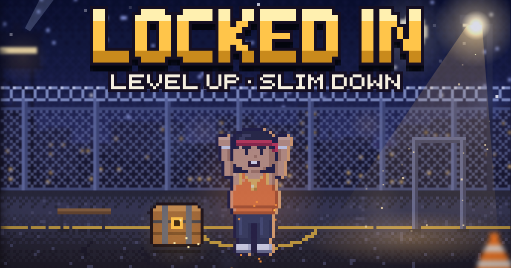

# Locked In

**Play it: https://toltecs101.github.io/Locked-in/**

A pixel-RPG weight-loss coach. Build a fighter, finish your daily missions, and level up while you slim down.

- **Today:** daily missions that open a loot chest, your calories and protein at a glance, and a weekly crystal boss
- **Eat:** quick food logging, one-tap meals (fast-food orders included), and a fasting timer from 12:12 to 18:6
- **Train:** jail-style workouts, each with a No weights and a Dumbbells version
- **Craving SOS:** turn a fast-food craving into a boss fight
- **Playbook:** 9 short chapters on how to actually lose the weight

Progress saves in the browser you play in. On a phone, add it to your Home Screen so it opens like an app.

The whole app is `index.html`, one self-contained file.

Not medical advice. Skip fasting if you're under 18, pregnant or breastfeeding, have diabetes or take blood-sugar medicine, or have had an eating disorder, and check with your doctor first if you have a health condition.
